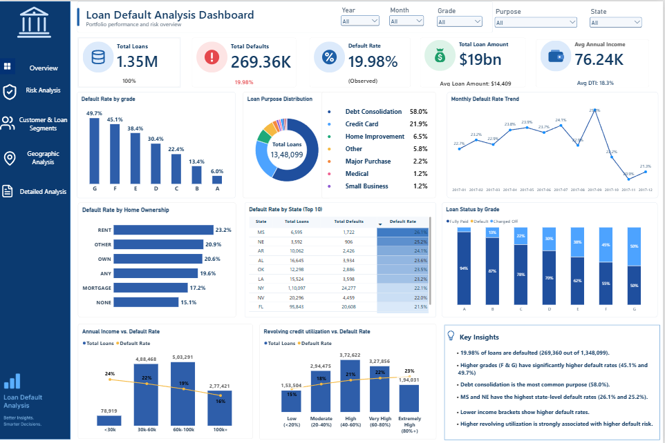
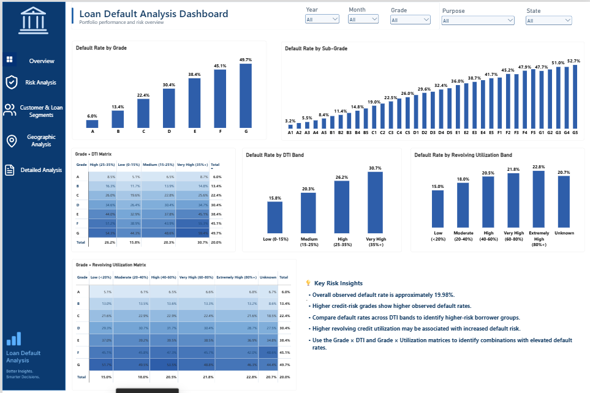
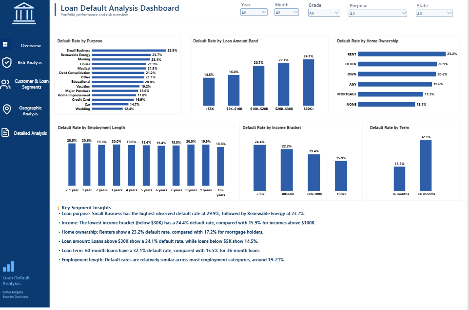
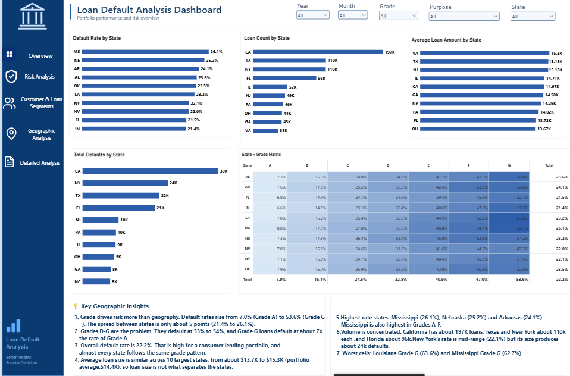
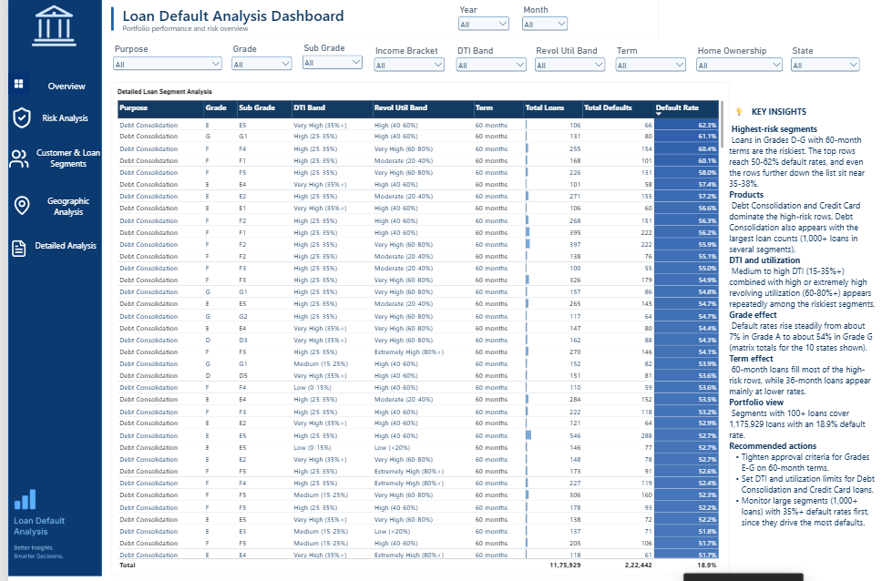

# Loan Default Risk Analysis | PostgreSQL & Power BI

An end-to-end analysis of **1.35 million loans** that uses PostgreSQL for data preparation and analysis and Power BI for an interactive 5-page dashboard. The project shows which borrower, loan and geographic characteristics are associated with higher default rates.

**Headline result:** 19.98% of loans defaulted overall, but the rate ranges from **6.0% (Grade A) to 49.7% (Grade G)**. Grade, loan term and DTI separate risk far more than geography or employment length.

---

## Table of Contents

1. [Dashboard Preview](#dashboard-preview)
2. [Business Problem](#business-problem)
3. [Tools and Technologies](#tools-and-technologies)
4. [Dataset and Preparation](#dataset-and-preparation)
5. [Key Performance Indicators](#key-performance-indicators)
6. [Dashboard Pages](#dashboard-pages)
7. [Key Findings](#key-findings)
8. [Recommendations](#recommendations)
9. [SQL Analysis](#sql-analysis)
10. [Repository Structure](#repository-structure)
11. [How to Explore the Project](#how-to-explore-the-project)
12. [Data Quality Notes](#data-quality-notes)
13. [Limitations](#limitations)
14. [Future Improvements](#future-improvements)
15. [Skills Demonstrated](#skills-demonstrated)
16. [Disclaimer](#disclaimer)
17. [Author](#author)

---

## Dashboard Preview

| Page | Preview |
|---|---|
| 1. Executive Overview |  |
| 2. Risk Analysis |  |
| 3. Customer & Loan Segments |  |
| 4. Geographic Analysis |  |
| 5. Detailed Analysis |  |

**[View or download the Power BI Dashboard (.pbix)](https://drive.google.com/file/d/1f_oy951PJMYAy_es_ThrGrjTgym2meLO/view?usp=sharing)**

The Power BI file is hosted on Google Drive because of its size. Ensure the link permissions allow viewers to access the file.

---

## Business Problem

Loan defaults create financial losses for lenders. Knowing which loan and borrower characteristics are associated with higher default rates helps lenders assess portfolio risk and prioritise monitoring.

The project answers:

- Which loan grades and sub-grades have the highest default rates?
- How do debt-to-income (DTI) ratio and revolving credit utilization relate to default risk?
- Which loan purposes show the highest default rates?
- How do income, home ownership and employment length relate to repayment outcomes?
- Do loan term and loan amount show different default patterns?
- How do default rates and default volumes vary by state?
- Which combinations of grade, DTI, utilization, term and purpose show elevated risk?
- How did the monthly default rate move over time?

---

## Tools and Technologies

| Tool | Use |
|---|---|
| **PostgreSQL** | Data cleaning, feature engineering, the `loans_enriched` view, and SQL analysis using CTEs, window functions and aggregation |
| **Power Query (M)** | Light transformations in Power BI, including handling blank purposes, label fixes and sort-order helper columns |
| **Microsoft Power BI** | Five-page interactive dashboard, slicers, heatmap matrices and conditional formatting |
| **DAX** | Measures for total loans, total defaults, default rate, averages and shares |
| **GitHub** | Version control and documentation |

---

## Dataset and Preparation

The analysis uses a loan dataset prepared in PostgreSQL through an enriched view named `loans_enriched`.

- **Source:** [Add dataset name and link]
- **Issue period:** [Add start and end dates]
- **Scope:** Resolved loans only, meaning loans with a final outcome (fully paid, charged off or default, including the credit-policy status variants). Loans still current or late have no final outcome, so including them would distort default rates.

### Default definition

`is_default` is `1` for loans with a charged-off or default status and `0` for fully paid loans, including the corresponding credit-policy status categories.

### Key fields

| Field | Description |
|---|---|
| `is_default` | 1 if the loan defaulted or was charged off, otherwise 0 |
| `grade`, `sub_grade` | Loan risk grade (A to G) and finer classification (A1 to G5) |
| `annual_inc`, `income_bracket` | Borrower income and category (<$30K, $30K–$60K, $60K–$100K, $100K+) |
| `dti`, `dti_band` | Debt-to-income ratio and band (Low 0–15%, Medium 15–25%, High 25–35%, Very High 35%+) |
| `revol_util`, `revol_util_band` | Revolving utilization and band (Low <20%, Moderate 20–40%, High 40–60%, Very High 60–80%, Extremely High 80%+, Unknown) |
| `loan_amnt`, loan amount band | Loan amount and band (<$5K, $5K–$10K, $10K–$20K, $20K–$30K, $30K+) |
| `purpose` | Stated purpose of the loan |
| `home_ownership` | Reported housing status |
| `emp_length` | Employment length |
| `term` | 36 or 60 months |
| `addr_state` | Borrower's state |
| `issue_d` | Loan issue date |

### Preparation steps

1. Loaded the raw data into a staging table, then built a typed, cleaned table.
2. Removed or flagged invalid values and kept resolved loans only.
3. Built derived bands (income, DTI, utilization, loan amount) in the `loans_enriched` view.
4. In Power Query, grouped blank purposes as **Unknown**, standardised labels (for example, "Educational") and added helper columns so bands sort in logical order rather than alphabetically.

---

## Key Performance Indicators

| KPI | Value |
|---|---:|
| Total Loans | 1,348,099 |
| Total Defaults | 269,360 |
| Overall Default Rate | 19.98% (observed) |
| Total Loan Amount | About $19 billion |
| Average Loan Amount | $14,409 |
| Average Annual Income | $76.24K |
| Average DTI | 18.3% |

Default rate is calculated as:

```text
Default Rate = Total Defaults / Total Loans × 100
```

In Power BI, the measure uses `DIVIDE()` and is formatted as a percentage. Revalidate these figures if the dataset, relationships or filtering logic changes.

---

## Dashboard Pages

All pages share slicers for **Year, Month, Grade, Purpose and State**. The Detailed Analysis page adds **Sub Grade, Income Bracket, DTI Band, Revolving Utilization Band, Term and Home Ownership**.

### 1. Executive Overview

Includes KPI cards, default rate by grade, loan purpose distribution, monthly default-rate trend, default rate by home ownership, top 10 states by default rate, loan status by grade (fully paid vs. default vs. charged off), and combo charts of income and revolving utilization against default rate.

### 2. Risk Analysis

Shows default rate by grade, sub-grade, DTI band and revolving utilization band. **Grade × DTI** and **Grade × Revolving Utilization** heatmap matrices expose combinations associated with higher risk.

### 3. Customer & Loan Segments

Shows default rate by loan purpose, loan amount band, home ownership, employment length, income bracket and loan term.

### 4. Geographic Analysis

Shows default rate by state (the 10 highest-rate states with at least 1,000 loans), loan count, average loan amount and total defaults for the largest states, plus a **State × Grade** heatmap matrix.

### 5. Detailed Analysis

A drill-down table of segments (purpose, grade, sub-grade, DTI band, utilization band and term) with loan counts, default counts and default rates. The table is ranked by default rate and filtered to segments with at least 100 loans.

---

## Key Findings

These are descriptive associations, not proof of causation.

### 1. Grade is the strongest risk signal

| Grade | A | B | C | D | E | F | G |
|---|---:|---:|---:|---:|---:|---:|---:|
| Default rate | 6.0% | 13.4% | 22.4% | 30.4% | 38.4% | 45.1% | 49.7% |

- Sub-grades range from **3.2% (A1)** to **52.7% (G5)**.
- The fully paid share falls from about 94% (Grade A) to about 50% (Grade G).
- Grade G loans default at roughly eight times the rate of Grade A.

### 2. DTI and revolving utilization

| DTI band | Low (0–15%) | Medium (15–25%) | High (25–35%) | Very High (35%+) |
|---|---:|---:|---:|---:|
| Default rate | 15.8% | 20.3% | 26.2% | 30.7% |

| Utilization | Low (<20%) | Moderate | High | Very High | Extremely High (80%+) | Unknown |
|---|---:|---:|---:|---:|---:|---:|
| Default rate | 15.0% | 18.0% | 20.5% | 21.8% | 22.8% | 20.7% |

- Higher DTI and higher utilization are both associated with higher default rates.
- The matrices show the DTI effect is larger in lower grades than in Grade A. The utilization effect within a grade is small and sometimes inconsistent, so part of the overall utilization pattern may reflect grade mix.

### 3. Loan characteristics

| Term | 36 months | 60 months |
|---|---:|---:|
| Default rate | 15.5% | 32.1% |

| Loan amount | <$5K | $5K–$10K | $10K–$20K | $20K–$30K | $30K+ |
|---|---:|---:|---:|---:|---:|
| Default rate | 14.5% | 16.0% | 20.7% | 22.1% | 24.1% |

Term, loan amount and grade are correlated: longer and larger loans tend to be lower-grade, so these effects overlap.

### 4. Loan purpose

| Purpose | Default rate | Purpose | Default rate |
|---|---:|---|---:|
| Small Business | 29.9% | Vacation | 19.2% |
| Renewable Energy | 23.7% | Major Purchase | 18.6% |
| Moving | 23.4% | Home Improvement | 17.8% |
| House | 21.9% | Credit Card | 16.9% |
| Medical | 21.8% | Car | 14.7% |
| Debt Consolidation | 21.2% | Wedding | 12.4% |
| Other | 21.1% | Educational | 20.8% |

Debt Consolidation is the largest purpose (about 58% of loans), so it dominates segment lists by volume even though its default rate (21.2%) is mid-range.

### 5. Borrower characteristics

- **Income:** <$30K 24.4%, $30K–$60K 22.2%, $60K–$100K 19.4%, $100K+ 15.9%.
- **Home ownership:** Rent 23.2%, Other 20.9%, Own 20.6%, Any 19.6%, Mortgage 17.2%, None 15.1%. Small categories such as Any and None have few loans.
- **Employment length:** Rates are nearly flat at 18.8% to 20.6%, so it is a weak differentiator.

### 6. Geography

- **Highest-rate states** (minimum 1,000 loans): Mississippi 26.1%, Nebraska 25.2%, Arkansas 24.1%, Alabama 23.6% and Oklahoma 23.5%.
- State rates differ by only about 5 percentage points (21.4% to 26.1% across the top 10), while grades differ by about 44 percentage points (6.0% to 49.7%). **Grade matters far more than state.**
- **Losses come from volume, not rate.** California has about 197K loans and about 39K defaults, followed by New York (24K defaults), Texas (22K) and Florida (21K). None of the highest-rate states appear in the top 10 by defaults.
- Average loan size is similar across the 10 largest states (about $13.7K to $15.3K), so loan size does not explain state differences.
- Worst State × Grade cells: Louisiana Grade G (63.6%) and Mississippi Grade G (62.7%). Cells like these hold fewer loans, so treat them as indicative.

### 7. Highest-risk segments

- The riskiest segments are 60-month loans in Grades D–G, with default rates of about 50% to 62%.
- Most also combine DTI above 25% with utilization above 20%, but some Grade E–G segments with low DTI or low utilization still exceed 50%, so grade outweighs either factor.
- Segments with 100+ loans cover 1,175,929 loans (about 87% of the portfolio), with 222,442 defaults and an 18.9% default rate.
- Most high-risk segments hold only a few hundred loans, so they are indicative rather than conclusive.

### 8. Trend

The monthly default-rate trend shown on the dashboard moves roughly between 21% and 25% during 2017. Recent months may be affected by incomplete loan outcomes, so interpret the late-2017 movement with caution.

---

## Recommendations

- Review approval and pricing criteria for Grades E–G, especially on 60-month terms.
- Consider DTI and utilization limits for high-volume purposes such as Debt Consolidation.
- Monitor large segments first, since they drive the most total defaults.
- Track high-volume states such as California and New York by default count, not just default rate.
- Use a minimum loan-count threshold (for example, 1,000) when ranking states or segments.

---

## SQL Analysis

The PostgreSQL work covers:

- Cleaning and classifying repayment outcomes.
- Deriving risk bands in the `loans_enriched` view.
- Aggregating loan and default counts across segments.
- Ranking states with window functions, using CTEs to apply minimum-volume thresholds.
- Building the source tables behind the matrices and the drill-down table.

Example: state ranking with a minimum volume.

```sql
WITH state_stats AS (
    SELECT
        addr_state,
        COUNT(*) AS loans,
        SUM(is_default) AS defaults,
        100.0 * AVG(is_default) AS default_rate
    FROM loans_enriched
    GROUP BY addr_state
    HAVING COUNT(*) >= 1000
)
SELECT
    addr_state,
    loans,
    defaults,
    ROUND(default_rate, 1) AS default_rate,
    RANK() OVER (ORDER BY default_rate DESC) AS risk_rank
FROM state_stats;
```

Validation query: the totals should match the dashboard KPIs.

```sql
SELECT
    COUNT(*) AS total_loans,
    SUM(is_default) AS total_defaults,
    ROUND(100.0 * SUM(is_default) / COUNT(*), 2) AS default_rate
FROM loans_enriched;
```

---

## Repository Structure

```text
loan-default-risk-analysis/
├── README.md
├── loan_default_analysis.sql
├── loans_enriched_view.sql
├── screenshots/
└── .gitignore
```

Add files as the corresponding project artifacts become available.

---

## How to Explore the Project

1. Review the SQL scripts to understand the data preparation and analysis.
2. Load the source data into a PostgreSQL database and create the required tables and views.
3. Run the scripts in order: cleaning, feature engineering, then analysis, after checking table and schema names.
4. Open the Power BI report in Power BI Desktop.
5. Point the report at your own database connection and refresh.
6. Compare the KPI cards with the validation query above.

The original dataset and database credentials are not included in this repository.

---

## Data Quality Notes

- **Missing purpose:** About 3.3% of loans had no recorded purpose and were grouped as "Unknown" so they stay in the totals.
- **Missing utilization:** Loans without a utilization value sit in an "Unknown" band (20.7% default rate).
- **Missing employment length:** Some loans have no employment length, which matters when filtering that field.
- **Resolved loans only:** Current and late loans were excluded because they have no final outcome.
- **Minimum volume:** State and segment rankings apply minimum loan counts so that small samples do not dominate.

---

## Limitations

- The analysis identifies associations, not causal relationships.
- Results depend on the dataset, the default definition and the filtering choices.
- Historical patterns may not represent future default behavior.
- Grade, term, loan amount, DTI and utilization are correlated, so effects overlap.
- Small categories (for example, some home-ownership groups and individual State × Grade cells) have few loans and are less reliable.
- Recent-period results may be affected by incomplete loan outcomes.
- The project is an analytical portfolio piece, not a production credit-scoring system.

---

## Future Improvements

- Add statistical tests (for example, chi-square) to check whether segment differences are meaningful.
- Build a predictive default model (logistic regression and gradient boosting) with a time-based train/test split.
- Evaluate with ROC-AUC, precision, recall and calibration, and avoid fields only known after issuance.
- Check missing values, class imbalance and potential bias across borrower groups.
- Add automated data-quality checks and a repeatable refresh workflow.
- Use dynamic DAX text for insights so they respond to slicers.

---

## Skills Demonstrated

SQL (CTEs, window functions, views) | Data cleaning and feature engineering | Power Query (M) | DAX | Dashboard design and conditional formatting | Data validation and reconciliation | Risk analytics | Documentation and communication of findings

---

## Disclaimer

This project is for educational and portfolio purposes. Findings are based on historical data and are not financial advice. They should not be the sole basis for real lending decisions.

---

## Author

**Syed Mohammed Ghouse**

Aspiring Data Analyst | PostgreSQL | Power BI | Business Analytics

GitHub: [s4184271-sys](https://github.com/s4184271-sys) | Project: [loan-default-risk-analysis](https://github.com/s4184271-sys/loan-default-risk-analysis)
